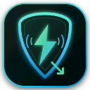
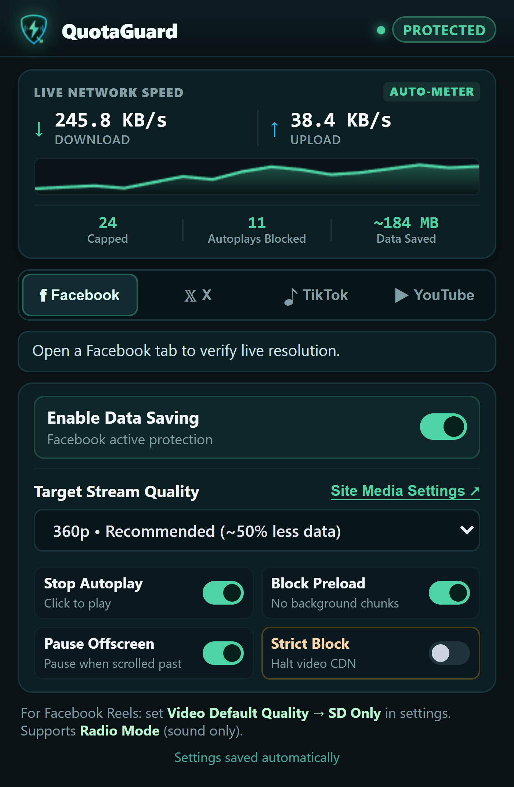
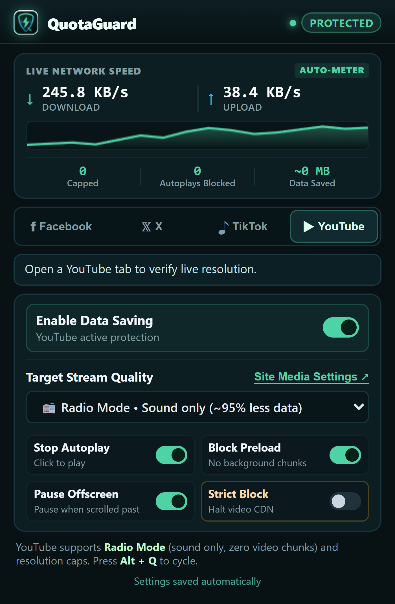
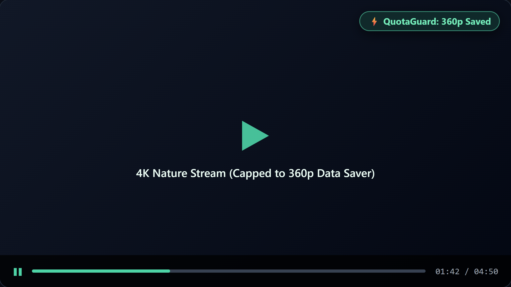

<p align="center">
  
</p>

<h1 align="center">QuotaGuard</h1>

<p align="center">
  <b>Smart Video Data Saver & Radio Mode for YouTube, Facebook, X (Twitter), and TikTok</b><br />
  Save 50% to 95% of your internet bandwidth on metered hotspots, limited mobile plans, and slow connections.
</p>

<p align="center">
  
  
  
  
  
</p>

<p align="center">
  <a href="https://github.com/HassanSalah120/quota-guard/releases/download/v1.2.0/quota-guard.crx">
    
  </a>
  &nbsp;
  <a href="https://github.com/HassanSalah120/quota-guard/releases/download/v1.2.0/quota-guard-v1.2.0.zip">
    
  </a>
</p>

---

## 📸 Screenshots

<p align="center">
  
  
</p>

<p align="center">
  <em>Left: Live telemetry hero card with rolling sparkline graph. Right: YouTube Radio Mode (Sound Only) active.</em>
</p>

<p align="center">
  
</p>
<p align="center">
  <em>Persistent on-video badge confirms real stream caps during playback without fading away.</em>
</p>

---

## 🌟 Key Features

### 📻 Radio Mode (Sound Only)
- **Zero Video Chunks Downloaded**: On supported platforms (**YouTube** and **Facebook DASH**), QuotaGuard isolates and serves only the pure audio stream, saving **up to 95% of data** (~64–128 kbps vs 1.5–4 Mbps).
- **Player & Video Visible**: Unlike basic scriptlets that merely hide the video using CSS `display: none` (which still downloads full video chunks in the background), QuotaGuard modifies network stream manifests so the browser downloads **only audio bytes** while the player interface, progress bar, play/pause, and comments remain completely visible and interactive.
- **Fail-Safe Platform Detection**: Automatically ignored on platforms that only deliver multiplexed video+audio streams (X and TikTok) to guarantee zero stream breakage.

### ⚡ True Stream-Level Quality Capping
- **YouTube**: Prunes high-resolution video formats from InnerTube's `/youtubei/v1/player` endpoint (`adaptiveFormats` and `formats`) and uses YouTube's HTML5 Player API (`setPlaybackQualityRange`) to permanently prevent automatic upscaling.
- **Facebook**: Intercepts standalone `.mpd` manifests and GraphQL `dash_manifest` responses, stripping high-bitrate representations while neutralizing progressive HD MP4 fallbacks.
- **X (Twitter)**: Intercepts `video.twimg.com/*.m3u8` master playlists, removing high-resolution variants before video segments are downloaded.
- **TikTok**: Prunes ByteDance XGPlayer multi-bitrate streams (`bitrateInfo` / `bit_rate`) and redirects all AVC/ByteVC1 playback addresses (`playAddr`, `playAddrH264`, `playAddrBytevc1`) to your chosen resolution.

### 📊 Real-Time Network Usage & Telemetry
- **Browser-Wide Network Metering**: Tracks total browser download and upload rates in real time via lightweight, non-blocking `webRequest` listeners.
- **Live Toolbar Badge & Hover Tooltip**: Displays current download speed directly on the extension icon (e.g. `200K`, `1.4M`) and full bidirectional usage on hover tooltip.
- **20-Second Rolling Sparkline**: Live animated HTML5 canvas chart inside the popup card.

### 🛑 Feed Autoplay & Background Preload Suppression
- Enforces `preload="none"` dynamically across video elements via `document.createElement` interception.
- Stops TikTok, YouTube, and X feeds from preloading upcoming offscreen videos in the background.
- Instantly authorizes playback upon genuine user click without breaking native player controls.
- Automatically pauses videos when scrolled out of view using `IntersectionObserver`.

### ⌨️ In-Page Keyboard Shortcut (`Alt + Q`)
- Press `Alt + Q` on any supported website to instantly cycle stream quality (`360p → 240p → Radio Mode → 480p → Default`) with a sleek on-screen toast notification.

---

## 📈 Data Savings Benchmark

Streaming 1 hour of video on standard mobile or metered plans:

| Stream Setting | Approx. Bitrate | 1 Hour Data Usage | Bandwidth Saved |
| :--- | :--- | :--- | :--- |
| **1080p HD (Default)** | ~3,500 kbps | **~1,575 MB (1.5 GB)** | *0% (Baseline)* |
| **720p HD** | ~2,000 kbps | **~900 MB** | **~43%** |
| **480p (Balanced)** | ~1,000 kbps | **~450 MB** | **~71%** |
| **360p (Recommended)** | ~550 kbps | **~245 MB** | **~84%** |
| **240p (Maximum)** | ~300 kbps | **~135 MB** | **~91%** |
| **📻 Radio Mode (Audio Only)** | ~96 kbps | **~43 MB** | **~97%** |

---

## 📋 Platform Capability Matrix

| Feature | YouTube | Facebook | X (Twitter) | TikTok |
| :--- | :---: | :---: | :---: | :---: |
| **Stream Interception** | InnerTube JSON | MPEG-DASH / GraphQL | HLS Master (`.m3u8`) | XGPlayer JSON |
| **Quality Ceiling (240p/360p/480p)** | ✅ | ✅ | ✅ | ✅ |
| **Radio Mode (Sound Only)** | ✅ | ✅ | *(Multiplexed)* | *(Multiplexed)* |
| **Autoplay Suppression** | ✅ | ✅ | ✅ | ✅ |
| **Preload Blocking** | ✅ | ✅ | ✅ | ✅ |
| **Offscreen Video Pausing** | ✅ | ✅ | ✅ | ✅ |
| **Strict Emergency Block** | ✅ | ✅ | ✅ | ✅ |
| **On-Video Quality Pill** | ✅ | ✅ | ✅ | ✅ |
| **Keyboard Shortcut (`Alt + Q`)** | ✅ | ✅ | ✅ | ✅ |

---

## 🚀 Installation & Browser Setup

### Method 1: Direct Install via `.crx` (Easiest — 15 Seconds)

1. Download [`quota-guard.crx`](https://github.com/HassanSalah120/quota-guard/releases/download/v1.2.0/quota-guard.crx).
2. Open your browser to the Extensions manager:
   - **Chrome / Brave:** `chrome://extensions`
   - **Microsoft Edge:** `edge://extensions`
3. Turn on the **Developer mode** switch in the top-right corner.
4. **Drag and drop** the downloaded `quota-guard.crx` file anywhere onto the extensions page.
5. Click **Add extension** when prompted. Done!

---

### Method 2: Load from `.zip` Release

1. Download and extract [`quota-guard-v1.2.0.zip`](https://github.com/HassanSalah120/quota-guard/releases/download/v1.2.0/quota-guard-v1.2.0.zip).
2. Open `chrome://extensions` (or `edge://extensions`) and enable **Developer mode**.
3. Click **Load unpacked** (top-left button).
4. Select the extracted folder containing `manifest.json`.

---

### Method 3: From Source (Developers)

```bash
git clone https://github.com/HassanSalah120/quota-guard.git
```
Then load the cloned directory via **Load unpacked** in your browser.

---

## 🧪 Automated Testing & Verification

QuotaGuard features a comprehensive test suite including pure unit tests, DOM smoke tests, and full headless browser integration tests via Chrome DevTools Protocol (CDP):

```bash
# Run unit tests
node tests/test.cjs            # Manifest, domains, defaults & assets
node tests/youtube-test.cjs     # YouTube InnerTube pruning & Radio Mode
node tests/tiktok-test.cjs      # TikTok XGPlayer bitrate adaptation
node tests/hls-test.cjs         # X (Twitter) HLS master playlist filtering
node tests/dash-test.cjs        # Facebook DASH & GraphQL manifest reduction

# Run popup UI smoke test
node tests/popup_smoke_test.mjs

# Run full end-to-end Chromium integration tests (13 tests)
node tests/real_browser_test.mjs
```

### Test Suite Output
```text
PASS: domains, defaults, quality preference, manifest, assets
PASS: YouTube adaptiveFormats pruning, resolution parsing, audio preservation, Radio Mode, and quality mappings
PASS: TikTok bitrateInfo/bit_rate pruning, gear resolution parsing, playAddr redirection, and fallback
PASS: HLS master filtering, portrait/landscape, low fallback, unlabelled bandwidth fallback, unchanged media playlist
PASS: DASH master filtering, portrait/landscape, lowest fallback, Radio Mode, FBQualityLabel, single stream, audio preservation, GraphQL JSON
=== Running Popup Smoke & UI Render Test ===
✓ Popup rendered cleanly (350px × 532px)
✓ Hero telemetry canvas and sparkline active
✓ 4 Segmented tabs (Facebook, X, TikTok, YouTube) bound and functional
=== POPUP UI SMOKE TEST PASSED 100% ===
=== Starting QuotaGuard Real Chromium Integration Tests ===
✓ TEST 1: Service Worker registered and active in MV3
✓ TEST 2: Page scripts (MAIN world) successfully injected on x.com
✓ TEST 3: Real HLS master playlist intercepted & capped to 360p on x.com
✓ TEST 4: Programmatic autoplay blocked with NotAllowedError
✓ TEST 5: User click immediately authorizes video without breaking native play buttons
✓ TEST 6: Facebook GraphQL DASH manifest intercepted via response.json() & capped to 360p
✓ TEST 7: DOMParser.prototype.parseFromString intercepts & caps DASH manifests
✓ TEST 8: On-video pill badge persists on video container
✓ TEST 9: Live browser network usage tracking active in background service worker
✓ TEST 10: TikTok feed API intercepted via response.json() & capped to 360p
✓ TEST 11: YouTube InnerTube API intercepted via response.json() & capped to 360p
✓ TEST 12: YouTube Radio Mode downloads only audio while keeping video element visible
✓ TEST 13: Hardened early window.ytInitialPlayerResponse and dynamic video preload blocking verified
✓ TEST 14: TikTok player container detection & 540p stream badge verified
=======================================================
  ALL 14 REAL BROWSER INTEGRATION TESTS PASSED 100%
=======================================================
```

---

## 🔒 Security & Privacy

- **Zero Tracking**: QuotaGuard does not collect, log, transmit, or monetize any browsing history, credentials, or personal data.
- **Local Storage Only**: All settings and statistics are kept strictly within Chrome's local storage (`chrome.storage.local`).
- **No Remote Code Execution**: Follows strict Chrome Web Store Manifest V3 guidelines with zero external scripts or eval execution.

---

## 📄 License

This project is licensed under the [MIT License](LICENSE).
