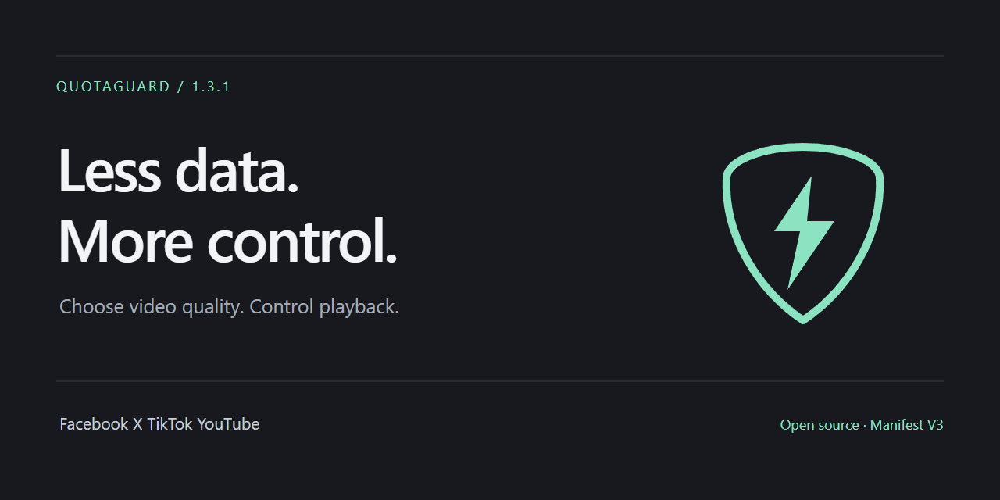
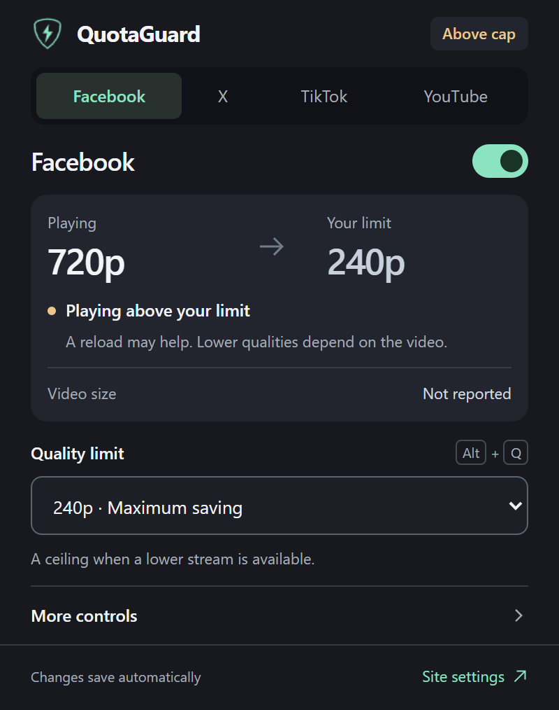
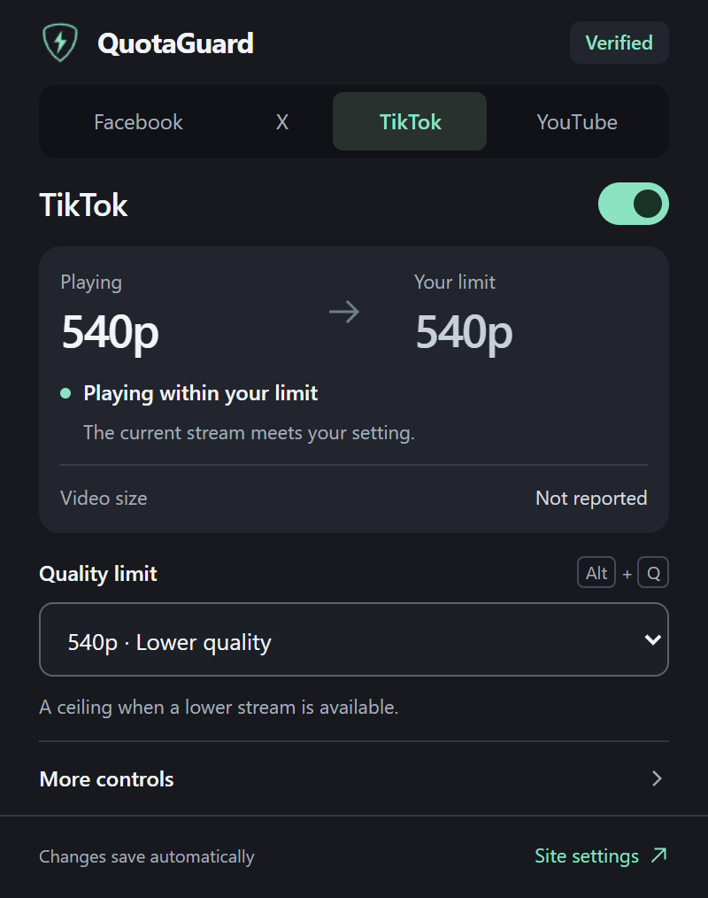

# QuotaGuard



A Chromium Manifest V3 extension for saving video data on Facebook, X, TikTok, and YouTube. Version 1.3.1.

**[Download v1.3.1 ZIP](https://github.com/HassanSalah120/quota-guard/releases/download/v1.3.1/quota-guard-v1.3.1.zip)** · [Release notes](https://github.com/HassanSalah120/quota-guard/releases/latest) · [Media pack](https://github.com/HassanSalah120/quota-guard/releases/download/v1.3.1/quota-guard-media-v1.3.1.zip) · [SHA-256 checksums](https://github.com/HassanSalah120/quota-guard/releases/download/v1.3.1/SHA256SUMS-v1.3.1.txt)

## Current interface

<p>
  
  
</p>

Actual interface with controlled example playback states. The requested ceiling and decoded quality are shown separately. These examples are not measurements from authenticated platform feeds.

<p>
  
  
</p>

Audio only remains labeled as a request. TikTok uses its actual 540p/720p options.


The chip appears on hover or keyboard focus. This controlled test recording shows real bytes appended to its MediaSource buffers; the small KB value is specific to the test recording. [All screenshots, icons, and promotional images](assets/README.md).

## What it does

- Filters supported HLS, DASH, YouTube player, and TikTok bitrate responses before the player selects a stream.
- Offers per-site quality ceilings, audio-only requests on Facebook/YouTube, and an emergency video-request block.
- Controls autoplay, preloading, and offscreen playback on Facebook, X, and TikTok. YouTube keeps control of its own playback lifecycle; these three switches are disabled there.
- Shows actual decoded resolution separately from the requested ceiling. A player above target is reported honestly, even if a manifest was filtered successfully.
- Provides a compact quality chip near the bottom-right of the player on hover or keyboard focus. The charcoal popup opens at 400px wide and separates actual quality from the requested ceiling. Click it or press Alt+Q to cycle the available settings for that site.
- Counts video sources observed playing within their ceiling and sources whose autoplay was stopped. Each element/source is counted once per page, even across playback loops and page mutations. Counts are saved locally and shared safely across tabs.

## Media size: measured values only

When a video is above target, the indicator can show:

- **`1.50 MB total`**: the full media resource size reported by its server through `Content-Length` (a full response) or the total in `Content-Range` (a partial response). This is the resource size, not downloaded bytes. A partial response’s length is never mistaken for the total.
- **`1.50 MB buffered`**: cumulative bytes supplied successfully to this video’s MediaSource audio/video buffers. Includes data supplied again after a seek or reuse; excludes transport overhead. This is neither the full video size nor an internet-usage meter.
- **Unavailable**: neither measurement can be attributed to this video. The popup says **Not reported** and the chip omits the size. Worker-owned MediaSource instances, some player implementations, missing headers, and unsupported media hosts can prevent measurement.

The tooltip and popup explain the measurement. MB means 1,000,000 bytes. There are no bitrate-based guesses, speculative savings totals, background downloads to discover size, or extra fetches of video data.

The extension reads headers using [Chrome webRequest](https://developer.chrome.com/docs/extensions/reference/api/webRequest) and observes the player’s existing [MediaSource append operations](https://www.w3.org/TR/media-source-2/#dom-sourcebuffer-appendbuffer).

## Facebook Reel navigation

The extension never opens or clicks Facebook player menus, Close buttons, or quality choices. Quality is applied through stream responses. A trusted click on a same-origin Reel link can authorize the newly mounted modal video once; unrelated feed autoplay remains blocked.

## Quality limits and audio only

Facebook, X, and YouTube offer 240p/360p/480p ceilings where supported. TikTok offers actual 540p/720p values. Available formats depend on the individual video; a lower quality cannot be created if the server does not provide one. Existing buffered playback may require a reload after a change.

Audio only requests remove video formats from supported intercepted responses. The UI reports the request separately from playback verification. It does not claim that video bytes are zero, or that every player accepts an audio-only manifest.

YouTube’s native player controls and its initial player object remain intact. Platform behavior can change independently of this extension.

## Install or update locally

1. Download the [installable release ZIP](https://github.com/HassanSalah120/quota-guard/releases/download/v1.3.1/quota-guard-v1.3.1.zip) and extract it into a permanent folder.
2. Open `chrome://extensions` or `edge://extensions`.
3. Enable Developer mode and select **Load unpacked**, then choose the folder containing `manifest.json`.
4. To update an existing unpacked installation, extract the new files into its existing folder, select **Reload** on its extension card, then refresh open supported websites. Keep the same installation to retain its local preferences.

Use the `quota-guard-v1.3.1.zip` release asset for installation. The separate media ZIP contains artwork and screenshots.

The extension requests access to the supported websites and their listed media CDNs, rather than every website. `webRequest` reads media response size headers; `declarativeNetRequest` applies the requested headers and video blocking rules. Settings/activity stay in local extension storage; source size observations are kept in page memory. There is no analytics endpoint or remote code.

Existing site preferences are retained. Old TikTok values are migrated to the quality labels they represented. Previous speculative MB savings and inflated counters are not imported into the new activity display; the old storage entries are left untouched.

## Verify

No build step, dependencies, or package installation is required. Use Node.js 22+ and Microsoft Edge on Windows for the browser harnesses, or set `QG_BROWSER_PATH` to a Chromium browser that supports loading unpacked extensions via command line.

```powershell
node tests/run-tests.cjs
```

This runs eight unit/regression scripts, the popup checks, and 22 browser integration checks. The browser checks use isolated temporary profiles and controlled website responses. The media-size checks use a real playable recording, decoded resolution, real MediaSource appends, and a native video response with a known byte length. They do not establish compatibility with current authenticated platform feeds.

Optional: set `QG_SCREENSHOT_DIR` to capture popup and player screenshots during browser tests.

## Reproduce release assets

```powershell
node scripts/generate_branding.mjs
node scripts/capture_screenshots.mjs
node scripts/generate_cws_assets.mjs
python scripts/package_release.py
```

The packaging script uses Python 3.9+ and an explicit runtime file allowlist. It verifies ZIP integrity, extracted file bytes, manifest version, image dimensions, and icon consistency, then writes both ZIPs and SHA-256 checksums to `dist/`. Development files, browser profiles, and signing keys are excluded. The extracted folder path is printed for testing with `QG_EXTENSION_PATH` in the popup and browser harnesses.

License: [MIT](LICENSE).
